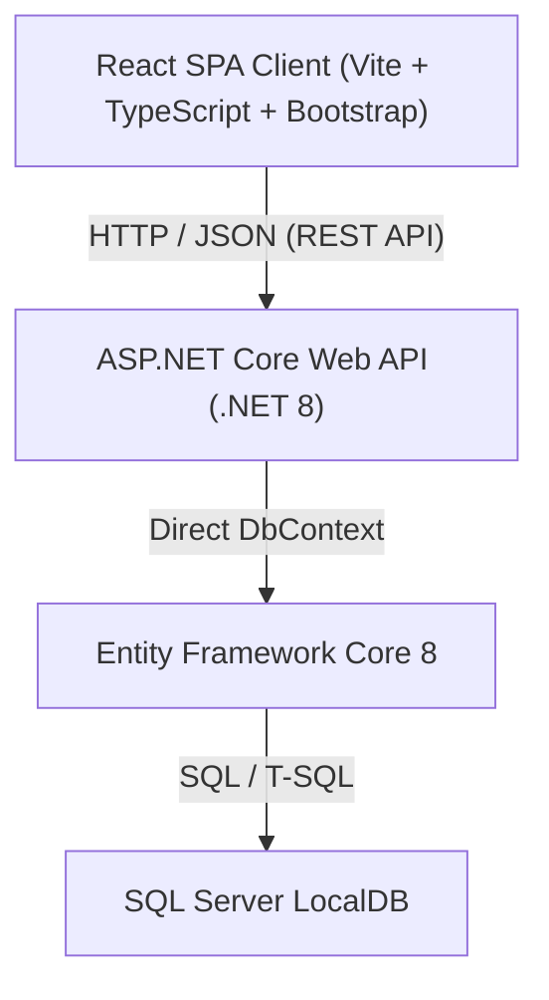
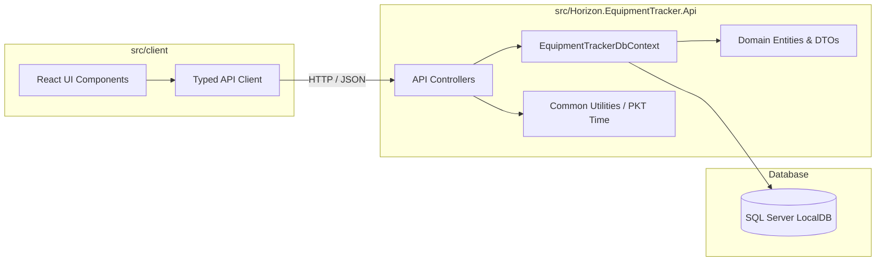
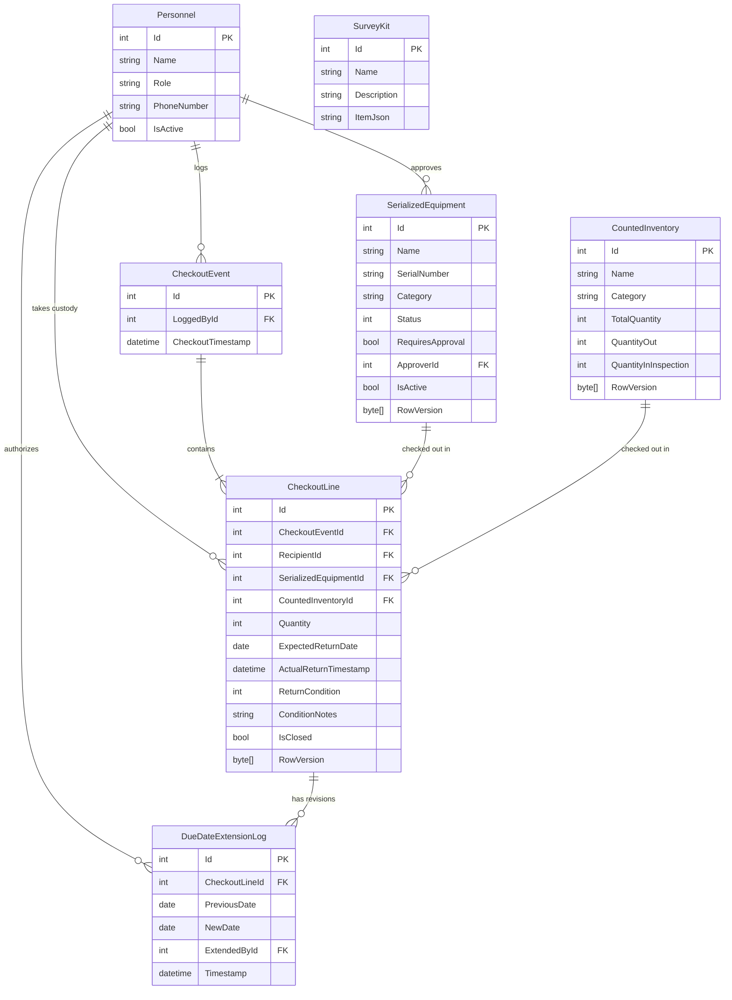

# Architecture Spine — Horizon Equipment Tracker

## Design Paradigm

The Horizon Equipment Tracker is structured as a **Two-Tier Modular Monolith** contained within a single repository: an ASP.NET Core Web API (.NET 8) and a React Single Page Application (Vite + TypeScript + Bootstrap 5.3). 

To keep implementation strictly sized for a one-week sprint, the backend organizes code by functional concern within a single API project rather than splitting into multi-project Clean Architecture class libraries. The database layer uses Entity Framework Core 8 directly with `DbContext`, eliminating superfluous repository and unit-of-work abstractions.



### Layer & Directory Mapping

- `src/Horizon.EquipmentTracker.Api/Controllers/`: HTTP endpoints exposing REST operations, input validation, and HTTP status codes.
- `src/Horizon.EquipmentTracker.Api/Data/`: `EquipmentTrackerDbContext`, entity type configurations, migrations, and database seed routines.
- `src/Horizon.EquipmentTracker.Api/Models/`: Domain entities, request/response DTOs, and enumeration definitions.
- `src/Horizon.EquipmentTracker.Api/Common/`: Cross-cutting helpers (Pakistan Standard Time date evaluator, PIN SHA-256 hasher, custom exception handling).
- `src/client/src/api/`: Typed HTTP client functions invoking API endpoints using the browser Fetch API.
- `src/client/src/components/`: Modular React components corresponding to operational workflows (Dashboard, CheckoutModal, ReturnModal, ApprovalsQueue, HistoryTable, AdminPanel).
- `src/client/src/types/`: TypeScript type interfaces mirroring backend API DTOs and enumerations.
- `src/client/src/utils/`: Timezone formatting helpers and WhatsApp click-to-chat URL generators.

---

## Invariants & Rules



### AD-1 — Single-Project Modular Backend Boundary [ADOPTED]

- **Binds:** all backend code, FR-1 through FR-23
- **Prevents:** multi-project abstraction overhead, circular dependencies, and project setup drag for a 1-week timeline
- **Rule:** All server-side code must reside in the single project `src/Horizon.EquipmentTracker.Api`. Do not create separate `.Domain`, `.Application`, or `.Infrastructure` projects. API endpoints are exposed exclusively through ASP.NET Core `[ApiController]`-decorated controller classes (one class per functional domain: `CheckoutsController`, `ReturnsController`, `ApprovalsController`, `EquipmentController`, `PersonnelController`, `HistoryController`, `AdminController`). Minimal API route groups are not used.

### AD-2 — Canonical Timezone and Business Date Boundary [ADOPTED]

- **Binds:** FR-4, FR-14, FR-16, FR-17, NFR-2
- **Prevents:** Timezone drift between client, server, and SQL database; incorrect overdue badges; midnight boundary errors
- **Rule:** Store all audit timestamps (`CreatedAt`, `CheckoutTimestamp`, `ActualReturnTimestamp`) in UTC using `DateTimeOffset` or UTC `DateTime`. Store expected return dates strictly as `DateOnly` (persisted as SQL `date`, formatted as `yyyy-MM-dd`). All business calendar day boundaries, today/tomorrow calculations, and overdue status checks must be evaluated against Pakistan Standard Time (PKT, UTC+05:00). An asset in `Out` status becomes Overdue strictly at 00:00 PKT on the calendar day following `ExpectedReturnDate`.

### AD-3 — Inventory Duality & Optimistic Concurrency [ADOPTED]

- **Binds:** FR-1, FR-6, FR-7, FR-8, FR-10, FR-11, FR-12
- **Prevents:** Incompatible entity tracking models; overselling counted inventory; duplicate state transitions on serialized items (double-checkout, double-approve) under concurrent requests
- **Rule:** Model individually tracked assets as `SerializedEquipment` records with a discrete lifecycle state machine (`Available`, `Out`, `PendingApproval`, `NeedsInspection`, `Lost`, `Deactivated`). Model shared bulk tools as `CountedInventory` records tracking integer pools (`TotalQuantity`, `QuantityOut`, `QuantityInInspection`). EF Core `RowVersion` (`byte[]`, mapped as SQL `rowversion`/`timestamp`) must be applied to all three concurrency-sensitive entities: `CountedInventory`, `SerializedEquipment`, and `CheckoutLine` (approval transitions). When EF Core throws `DbUpdateConcurrencyException`, controllers must catch it and return HTTP 409 Conflict with a `ProblemDetails` body whose `detail` is a user-readable message (e.g. `"This item was just updated by another request. Please refresh and try again."`). The React UI must surface this message in the active modal so the surveyor knows to retry.

### AD-4 — Trust-First Passwordless Field Attribution [ADOPTED]

- **Binds:** FR-1, FR-2, FR-8, NG-1
- **Prevents:** Morning field dispatch friction, credential fatigue, and missing attribution records
- **Rule:** Checkout and return endpoints require zero user authentication tokens, passwords, or session cookies. Every checkout line must explicitly record both `RecipientId` (the staff member receiving physical custody) and `LoggedById` (the staff member recording the transaction). Both identifiers must reference active `Personnel` (`IsActive == true`).

### AD-5 — Queue-Only Restricted Approval with Operator PIN Gate [ADOPTED]

- **Binds:** FR-11, FR-12, FR-13
- **Prevents:** Unauthorized deployment of regulated assets (the drone), dual approval code paths, and administrative bypass of flight authority
- **Rule:** Any checkout containing an item with `RequiresApproval == true` must transition the item strictly into `PendingApproval`. It cannot enter `Out` directly from the checkout form. The item can only be released to `Out` via the `/api/approvals/:id/approve` endpoint upon submission of a valid Approver PIN matching the cryptographic hash of the assigned approver (Hamza). There is strictly no inline PIN entry on the checkout screen, and strictly no Admin PIN override for approvals.

### AD-6 — Admin PIN Header Authorization Boundary [ADOPTED]

- **Binds:** FR-16, FR-19, FR-20, FR-21, FR-22
- **Prevents:** Accidental configuration tampering, unvetted damage clearance, unmonitored overdue extensions, and catalog corruption
- **Rule:** Privileged administrative endpoints (clearing an item from `NeedsInspection`, marking an asset `Lost`, extending an already overdue checkout line, and adding/editing/deactivating equipment or personnel) require the HTTP header `X-Admin-PIN`. The API verifies this value against `AdminPinHash` (SHA-256) stored in `appsettings.json`. Requests failing verification must be rejected with HTTP 401 Unauthorized.

### AD-7 — Return Condition Verification and Instant Damage Quarantine [ADOPTED]

- **Binds:** FR-8, FR-9, FR-10, FR-20
- **Prevents:** Silent returns of damaged gear and re-dispatching broken instruments to remote field sites
- **Rule:** Every return request payload must include a mandatory `Condition` enum value (`Good` or `Damaged`) and an optional `ConditionNotes` string. Returning an item as `Damaged` immediately updates `SerializedEquipment.Status` to `NeedsInspection` or increments `CountedInventory.QuantityInInspection`. Quarantined items are immediately locked from checkout across all clients and can only be cleared back to `Available` via an administrative action secured by the Admin PIN.

### AD-8 — Delinquency Calculation & Overdue Extension Gate [ADOPTED]

- **Binds:** FR-14, FR-16
- **Prevents:** Unauthorized self-extension of overdue gear, unmonitored prolonged holds, and ambiguous delinquency status
- **Rule:** An item in `Out` status is Overdue if `ExpectedReturnDate < CurrentDateInPKT`. Field surveyors can self-serve an extension on their active checkout lines until 23:59:59 PKT on the return date. Once an item is Overdue (after 00:00 PKT the following day), an extension can only be granted by Saima or an administrator possessing the Admin PIN. Every extension must append an immutable record to `DueDateExtensionLog` capturing `CheckoutLineId`, `PreviousDate`, `NewDate`, `ExtendedById`, and `Timestamp`. The operational dashboard must display a visible cumulative extension count indicator for any extended line.

### AD-9 — Client-Side WhatsApp Link Formatting [ADOPTED]

- **Binds:** FR-15, NG-2
- **Prevents:** Server-side messaging dependencies, third-party messaging costs, and broken phone number URLs
- **Rule:** WhatsApp reminder links are constructed entirely on the client using the standardized URI protocol `https://wa.me/{FormattedPhone}?text={EncodedMessage}`. The application normalizes local Pakistani phone numbers (e.g. `03001234567` or `+923001234567`) to international format without plus signs or leading zeros (`923001234567`). The reminder button is active on both "Due Today" and "Overdue" checkout rows.

### AD-10 — Cold-Start Database Migration and First-Run Seeding [ADOPTED]

- **Binds:** FR-23, NFR-4
- **Prevents:** Manual SQL database setup, missing seed catalogs, and cold-start configuration drift
- **Rule:** On application boot in `Program.cs`, the backend automatically calls `context.Database.Migrate()` to apply all pending EF Core migrations. If `!context.Personnel.Any()`, the API executes `DatabaseSeeder.SeedAsync()` to populate realistic seed personnel, serialized equipment, counted inventory pools, kit templates, demo checkouts (including one overdue checkout and one historical checkout), and SHA-256 hashed default PIN credentials (`9999` for Admin, `1234` for Hamza).

---

## Consistency Conventions

| Concern | Convention |
| --- | --- |
| Backend Naming | PascalCase for C# classes, records, methods, and properties; camelCase for parameters and local variables. |
| Database Naming | PascalCase for SQL Server table and column names (`Personnel`, `SerializedEquipment`, `CountedInventory`, `CheckoutEvents`, `CheckoutLines`, `SurveyKits`, `DueDateExtensionLogs`). |
| Frontend Naming | PascalCase for React component files (`DashboardBoard.tsx`, `CheckoutModal.tsx`); camelCase for hooks, utilities, and TypeScript object properties. |
| REST API URLs | Lowercase plural nouns with kebab-case route segments (`/api/personnel`, `/api/equipment`, `/api/checkouts`, `/api/returns`, `/api/approvals`, `/api/admin`). |
| Identifiers | Integer primary keys (`int Id`) with database identity autoincrement for simplicity and low overhead. |
| Date & Time Formats | Timestamps in ISO-8601 UTC string format (`2026-10-23T07:30:00Z`); business dates in ISO-8601 format (`yyyy-MM-dd`). |
| API Error Responses | Standard ASP.NET Core `ProblemDetails` JSON responses with `title`, `status`, `detail`, and `errors`. Concurrency conflicts always return HTTP 409 with a human-readable `detail`. |
| Client State Management | React server state managed exclusively via typed native `fetch` inside custom `use*` hooks (e.g. `useEquipment`, `useCheckouts`). No external state-management library or data-fetching library is added. |
| Concurrency Error Surfacing | HTTP 409 responses from the API must be detected in the fetch wrapper and surfaced as an inline error message within the currently open modal (not as a full-page error or silent failure), so the user can refresh and retry without losing context. |

---

## Stack

| Name | Version |
| --- | --- |
| .NET | 8.0 |
| ASP.NET Core Web API | 8.0 |
| Entity Framework Core | 8.0 |
| SQL Server LocalDB | 2022 (v16.0) |
| React | 19.0 |
| Vite | 6.0 |
| TypeScript | 5.7 |
| Bootstrap | 5.3 |

---

## Structural Seed



### Source Tree Layout

```text
e:\horizon-equipment-tracker\
├── src\
│   ├── Horizon.EquipmentTracker.Api\
│   │   ├── Common\
│   │   │   ├── Constants.cs
│   │   │   ├── DateTimeExtensions.cs
│   │   │   └── PinHasher.cs
│   │   ├── Controllers\
│   │   │   ├── AdminController.cs
│   │   │   ├── ApprovalsController.cs
│   │   │   ├── CheckoutsController.cs
│   │   │   ├── EquipmentController.cs
│   │   │   ├── HistoryController.cs
│   │   │   ├── PersonnelController.cs
│   │   │   └── ReturnsController.cs
│   │   ├── Data\
│   │   │   ├── Configurations\
│   │   │   ├── DatabaseSeeder.cs
│   │   │   ├── EquipmentTrackerDbContext.cs
│   │   │   └── Migrations\
│   │   ├── Models\
│   │   │   ├── DTOs\
│   │   │   ├── Entities\
│   │   │   └── Enums\
│   │   ├── appsettings.json
│   │   ├── Horizon.EquipmentTracker.Api.csproj
│   │   └── Program.cs
│   └── client\
│       ├── public\
│       ├── src\
│       │   ├── api\
│       │   │   └── apiClient.ts
│       │   ├── components\
│       │   │   ├── AdminModal.tsx
│       │   │   ├── ApprovalsQueue.tsx
│       │   │   ├── CheckoutModal.tsx
│       │   │   ├── DashboardBoard.tsx
│       │   │   ├── ExtensionModal.tsx
│       │   │   ├── HistoryTable.tsx
│       │   │   ├── Navbar.tsx
│       │   │   └── ReturnModal.tsx
│       │   ├── types\
│       │   │   └── index.ts
│       │   ├── utils\
│       │   │   ├── dateUtils.ts
│       │   │   └── whatsapp.ts
│       │   ├── App.tsx
│       │   ├── index.css
│       │   └── main.tsx
│       ├── index.html
│       ├── package.json
│       ├── tsconfig.json
│       └── vite.config.ts
├── docs\
│   └── 00-client-input.md
├── _bmad-output\
│   └── initiative-equipment-tracker\
│       ├── brief-equipment-tracker\
│       ├── prd-equipment-tracker\
│       └── architecture-equipment-tracker\
│           ├── .memlog.md
│           └── architecture-equipment-tracker.md
└── README.md
```

---

## Capability → Architecture Map

| Capability / Requirement | Lives in | Governed by |
| --- | --- | --- |
| FR-1: Passwordless Recipient Selection & Multi-Line Submission | `CheckoutsController`, `CheckoutModal.tsx` | AD-1, AD-4 |
| FR-2: Dual Attribution Logging (`RecipientId`, `LoggedById`) | `CheckoutEvent`, `CheckoutLine`, `CheckoutsController` | AD-4 |
| FR-3: Survey Kit Configuration Templates | `SurveyKit`, `CheckoutsController`, `CheckoutModal.tsx` | AD-1 |
| FR-4: Mandatory Expected Return Date with Quick Selectors | `CheckoutLine`, `DateTimeExtensions`, `dateUtils.ts` | AD-2 |
| FR-5: Real-Time Equipment Custody Grid | `EquipmentController`, `DashboardBoard.tsx` | AD-1, AD-3 |
| FR-6: Counted Inventory Pool Visualization | `CountedInventory`, `DashboardBoard.tsx` | AD-3 |
| FR-7: Status-Based Checkout Lockouts | `EquipmentTrackerDbContext`, `CheckoutsController` | AD-3 |
| FR-8: Per-Line and Partial Quantity Returns | `ReturnsController`, `ReturnModal.tsx` | AD-3, AD-7 |
| FR-9: Mandatory Condition Prompt (`Good` vs `Damaged`) | `ReturnModal.tsx`, `ReturnsController` | AD-7 |
| FR-10: Immediate Damage Quarantine (`NeedsInspection`) | `ReturnsController`, `SerializedEquipment` | AD-7 |
| FR-11: Configurable Per-Item Approval Gate | `SerializedEquipment`, `AdminController` | AD-5, AD-6 |
| FR-12: Pending Approval Queue & Cancellation | `ApprovalsController`, `ApprovalsQueue.tsx` | AD-5 |
| FR-13: Approver PIN Verification & Custody Release | `ApprovalsController`, `PinHasher.cs` | AD-5 |
| FR-14: Overdue Asset Calculation in PKT | `DateTimeExtensions.cs`, `DashboardBoard.tsx` | AD-2, AD-8 |
| FR-15: One-Click WhatsApp (`wa.me`) Reminder Generation | `whatsapp.ts`, `DashboardBoard.tsx` | AD-9 |
| FR-16: Due Date Extension Authority & Revision Log | `DueDateExtensionLog`, `CheckoutsController`, `ExtensionModal.tsx` | AD-6, AD-8 |
| FR-17: On-Screen Retrospective Custody Table with Interval Overlap | `HistoryController`, `HistoryTable.tsx` | AD-2 |
| FR-18: Multi-Criteria Filter Presets (`This Month`, `Last Month`) | `HistoryController`, `HistoryTable.tsx` | AD-2 |
| FR-19: Admin PIN Protection for Privileged Operations | `AdminController`, `AdminModal.tsx`, `PinHasher.cs` | AD-6 |
| FR-20: Inspection Clearance Workflow | `AdminController`, `SerializedEquipment` | AD-6, AD-7 |
| FR-21: Permanent Loss Flagging (`Lost` State) | `AdminController`, `SerializedEquipment` | AD-6 |
| FR-22: Personnel & Equipment Catalog Administration | `AdminController`, `PersonnelController` | AD-6 |
| FR-23: First-Run Database Auto-Seeding | `Program.cs`, `DatabaseSeeder.cs` | AD-10 |

---

## Deferred

| Capability / Concern | Deferred To | Rationale for Deferral |
| --- | --- | --- |
| Automated WhatsApp Business API / Twilio Webhooks | v2 | Incurs recurring third-party API costs, Meta business verification delays, and infrastructure complexity not needed for ~14 surveyors. |
| Job Site & Client Project Geo-Tagging | v2 | The immediate pain is equipment custody ("who holds what") rather than GIS mapping; client explicitly requested simple name attribution first. |
| Sensor Calibration & Maintenance Scheduling | v2 | Secondary equipment lifecycle concern; priority for 1-week build is tracking daily checkout/return custody and stopping redundant purchases. |
| Barcode & QR Scanner Hardware Integration | v2 | Field staff operate quickly via 10-second touch UI on mobile phones; physical scanners add hardware costs and driver complexity. |
| Native iOS/Android Application Packaging | v2 | Responsive web app accessible via mobile browser satisfies all operational field requirements without app store review overhead. |
| User Accounts & Role-Based Access Control (RBAC) | v2 | Violates client trust-first velocity constraint; shared Admin PIN and Approver PIN provide sufficient operational protection. |
| Distributed Cache (Redis) & Message Queues (RabbitMQ) | Not Planned | Unnecessary architectural bloat for 25 users; SQL Server LocalDB and EF Core handle all concurrency and throughput requirements effortlessly. |
