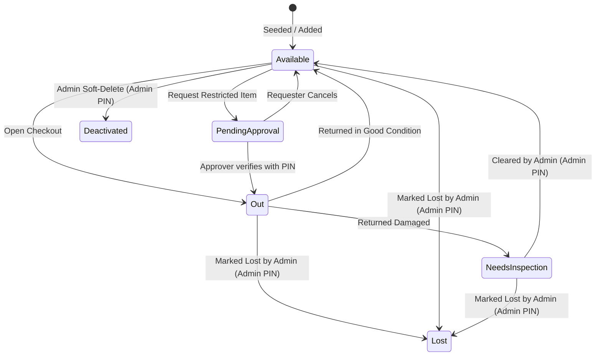

# Addendum: Horizon Equipment Tracker Technical & Design Details

This addendum preserves detailed technical specifications, state machines, operational models, and architectural constraints elicited during the product brief workflow. It serves as foundational reference material for downstream PRD authoring (`bmad-agent-po` / `bmad-prd`) and architecture design (`bmad-agent-architect` / `bmad-architecture`).

---

## 1. Technical Constraints & Repository Structure

As established in client requirements and developer technical decisions:

- **Backend**: .NET 9, C#, ASP.NET Core Web API, Entity Framework Core (EF Core).
- **Database**: SQL Server (SQL Server LocalDB for zero-overhead local development).
- **Frontend**: React (Vite) + TypeScript, styled with Bootstrap 5.
- **Project Structure**: A unified mono-repository:
  ```text
  e:\horizon-equipment-tracker\
  ├── src\
  │   ├── Horizon.EquipmentTracker.Api\   # ASP.NET Core Web API (.NET 9)
  │   └── client\                         # React + Vite + TypeScript (Bootstrap)
  ├── docs\                               # Project documentation & brief artifacts
  └── README.md                           # Local execution & verification guide
  ```
- **Local Startup Requirement**: The system must run locally via a short, documented sequence of commands (`dotnet run` and `npm run dev`) with automatic migration execution.

---

## 2. Equipment Data Model & State Transitions

### A. Asset Classification
1. **Individually Tracked Items** (High-Value / Serialized):
   - Examples: Total stations, GPS rovers, drones, specialized laptops.
   - Tracked as discrete individual rows with unique identifiers, serial numbers, current custody, and exact lifecycle status.
2. **Counted / Bulk Items**:
   - Examples: Tripods (4), Field Tablets (6).
   - Tracked by total count. 
   - Calculation: $\text{Available Quantity} = \text{Total Quantity} - \text{Quantity Out} - \text{Quantity in Inspection}$.
   - Supports partial checkout and partial return (e.g., return 2 of 3 tripods).

### B. Serialized Asset Lifecycle State Machine



- **Checkout Lockouts**: An item cannot be checked out if its status is `Out`, `Pending Approval`, `Needs Inspection`, `Lost`, or `Deactivated`.
- **Counted Items Lockout**: Checkouts are prohibited if the requested quantity exceeds the current `Available Quantity`.

---

## 3. Checkout, Approval, and Return Flows

### A. Morning Checkout & Identity Handling
- **Frictionless Trust Model**: Surveyors do not have accounts or passwords. The checkout screen provides a simple dropdown/selector of active personnel.
- **Dual Attribution**: Every checkout line explicitly records:
  - `RecipientId`: The person who physically took custody of the item.
  - `LoggedById`: The person who entered the record (e.g., the surveyor self-serving or Saima entering on their behalf).
- **Multi-Line Checkouts**: Multiple equipment lines can be combined in a single checkout event, but each line is tracked and closed independently in the database.
- **Survey Kits**: Kits are saved configuration templates that pre-populate checkout item lines. A kit is not an entity that holds physical assets; once submitted, each item is tracked as an independent custody record.
- **Mandatory Expected Return Date**: Required at checkout. Fast buttons provide `Today` (default), `Tomorrow`, or a custom date picker. Dates are evaluated in Pakistan Standard Time (PKT, UTC+5).

### B. Approval Workflow for Restricted Gear
- **Per-Item Configuration**:
  - `RequiresApproval`: Boolean flag.
  - `ApproverId`: Reference to the authorized person (e.g., Hamza).
- **Default Seed States**:
  - Drone: `RequiresApproval = true`, `ApproverId = Hamza`.
  - New GPS Rover: `RequiresApproval = false` (Tariq undecided; configurable via Admin UI).
  - All other assets: `RequiresApproval = false`.
- **Approval Mechanics**:
  - Request puts item in `Pending Approval`.
  - Requester can cancel a pending request, returning the item to `Available`.
  - No auto-timeout; request remains pending until acted upon.
  - Designated approver approves by entering their personal PIN.

### C. Return, Damage, and Extension Handling
- **Per-Line Returns**: Checkouts are closed line-by-line. Counted items support partial quantity returns.
- **Mandatory Condition Prompt**: Return requires selecting `Good` or `Damaged` (with an optional condition description note).
- **Damage Quarantine**: Marking an item `Damaged` moves it immediately to `Needs Inspection`. For counted items, the damaged count is recorded and deducted from the available pool.
- **Due Date Extensions**: A checkout due date can be extended by either the holder or Saima. Every extension appends an entry to an audit log recording previous due date, new due date, timestamp, and user.

---

## 4. Administrative Security & Access Model

Recognizing that Horizon operates on trust, standard day-to-day interactions have no passwords. To prevent accidental misconfiguration or unvetted status overrides, administrative actions are protected by a shared **Admin PIN**:

- **Protected Admin Actions**:
  - Clearing an item from `Needs Inspection` back to `Available`.
  - Marking an item as `Lost`.
  - Toggling `RequiresApproval` or changing the assigned approver for an item.
  - Adding, editing, or deactivating personnel or equipment records.
- **Approver PIN**:
  - Hamza possesses an Approver PIN strictly used to release `Pending Approval` items.
- **Credential Storage**:
  - Default PINs are defined in `appsettings.json` for demo/development purposes and stored as cryptographic hashes. Demo PIN values are documented in `README.md`.

---

## 5. Overdue Tracking & WhatsApp Reminder Integration

### A. Overdue Criteria
An item is marked **Overdue** if:
$$\text{Expected Return Date} < \text{Current Date in PKT} \quad \text{AND} \quad \text{Status} == \text{Out}$$

### B. WhatsApp Click-to-Chat (`wa.me`)
- The system does not connect directly to WhatsApp Business APIs (eliminates verification hurdles, costs, and external dependencies).
- When an item is overdue or due today, Saima’s dashboard displays a **"Send WhatsApp Reminder"** button.
- Clicking the button launches:
  `https://wa.me/<PhoneNumber>?text=<EncodedMessage>`
- **Template Example**:
  > *"Salam [Surveyor Name], this is Horizon Survey office. [Equipment Name] was due back on [Date]. Please bring it back to the office or let Saima know if you need an extension."*

---

## 6. History & Audit Log Specification

- **Screen-Based History**: An on-screen tabular log providing retrospective visibility into equipment usage.
- **Date Filtering Presets**:
  - `Last Month` (e.g., 1st to end of previous calendar month).
  - `This Month`.
  - `Custom Range` (from date to to date).
- **Interval Overlap Matching**: A checkout matches the selected date range if its custody duration $[T_{\text{checkout}}, T_{\text{return}}]$ overlaps the selected window $[\text{Start}, \text{End}]$. For items currently out, $T_{\text{return}}$ is evaluated as the current date.
- **Additional Filters**: Filterable by Surveyor (`PersonId`) and Equipment (`EquipmentId` / `Category`).
- **Data Integrity**: Records are immutable; checkouts are closed via return timestamps, never hard deleted. Personnel and equipment are soft-deleted via deactivation flags.

---

## 7. First-Run Seed & Demo Data Specification

Upon startup, if the database contains no personnel records, an automatic seeding routine populates the following demonstration dataset:

1. **Personnel**:
   - Tariq (Owner / Admin)
   - Saima (Office Admin)
   - Hamza (Licensed Drone Pilot / Approver)
   - Ali, Bilal, Usman, Farhan (Sample Field Surveyors with Pakistani mobile numbers `+92300...`)
2. **Equipment**:
   - Total Station #1 (Leica TS07) — Serial `TS-1001` (Individually Tracked, Open)
   - Total Station #2 (Sokkia iX) — Serial `TS-1002` (Individually Tracked, Open)
   - GPS Rover #1 (Trimble R12) — Serial `GPS-2001` (Individually Tracked, Open)
   - GPS Rover #2 (Trimble R12) — Serial `GPS-2002` (Individually Tracked, New Rover, Approval=Off)
   - Drone (DJI Matrice 300 RTK) — Serial `DRN-3001` (Individually Tracked, Approval=On, Approver=Hamza)
   - Heavy-duty Tripods — Counted Inventory (Total Quantity = 4)
   - Rugged Field Tablets (Samsung Active) — Counted Inventory (Total Quantity = 6)
3. **Kits**:
   - "Standard Total Station Kit" template: Total Station + 1 Tripod.
   - "GPS RTK Rover Kit" template: GPS Rover + 1 Field Tablet.
4. **Demonstrable Checkouts**:
   - One active overdue checkout (e.g., GPS Rover #1 checked out to Ali 5 days ago, due 2 days ago).
   - One historical checkout from last month (returned in good condition).
5. **Configured Demo PINs**:
   - Admin PIN (Saima / Tariq): `9999` (hashed in seed)
   - Drone Approver PIN (Hamza): `1234` (hashed in seed)
