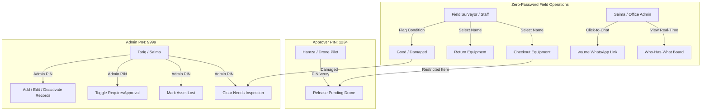

# PRD: Horizon Equipment Tracker

## 0. Document Purpose

This Product Requirements Document (PRD) defines the complete functional and non-functional specifications for the **Horizon Equipment Tracker**, an internal operational web application built for **Horizon Survey Services** in Lahore, Pakistan. 

This document serves as the authoritative specification for downstream product ownership (`bmad-agent-po`), architectural design (`bmad-agent-architect` / `bmad-architecture`), user experience specification (`bmad-agent-ux-designer` / `bmad-ux`), and engineering implementation (`bmad-agent-dev` / `bmad-build`). 

It directly operationalizes the settled strategic direction established in [brief-equipment-tracker.md](file:///e:/horizon-equipment-tracker/_bmad-output/initiative-equipment-tracker/brief-equipment-tracker/brief-equipment-tracker.md) and technical foundations from [addendum.md](file:///e:/horizon-equipment-tracker/_bmad-output/initiative-equipment-tracker/brief-equipment-tracker/addendum.md), synthesized from client input in [00-client-input.md](file:///e:/horizon-equipment-tracker/docs/00-client-input.md). 

All domain concepts adhere strictly to the Glossary (§3). Functional requirements are grouped into features (§4) and globally numbered (`FR-1` through `FR-23`) to ensure persistent traceability across backlog slicing and implementation. Any inferences beyond the source brief are tagged inline as `[ASSUMPTION: ...]` and indexed in §9.

---

## 1. Vision

Horizon Survey Services operates high-stakes land-surveying engagements across Punjab with a specialized team of 25 staff, including 14 field surveyors. The firm owns millions of rupees in mission-critical optical and satellite instruments—total stations, GPS rovers, drones, tripods, and rugged field tablets. Historically, asset custody was governed solely by informal verbal trust. Equipment was picked up at dawn and driven to remote job sites without central records. This lack of visibility caused operational paralysis, frantic phone calls to the office, aborted field days due to undetected equipment damage, and an extreme capital blunder: purchasing a redundant PKR 1.1M (11 lakh) GPS rover because the company's existing unit was misplaced inside a surveyor's car boot for three weeks.

The Horizon Equipment Tracker solves this crisis by introducing a high-velocity, mobile-first custody and inventory platform designed specifically for the realities of field operations. It rejects heavy enterprise IT hurdles—such as individual user accounts, mandatory passwords, and cumbersome multi-screen forms—which field crews operating under morning dispatch pressure would inevitably abandon. Instead, it pairs a frictionless, passwordless checkout flow (completed in under 15 seconds) with targeted, protective business guardrails:
1. **Absolute Real-Time Custody Visibility**: A single-pane office dashboard gives the owner (Mr. Tariq) and office administrator (Saima) instant visibility into which surveyor holds which instrument, what items are due today, and what gear is overdue.
2. **Selective Safety & Compliance Gates**: High-risk assets (such as the drone, legally requiring licensed pilot Hamza's sign-off) are quarantined behind personal PIN authorization before release.
3. **Zero Silent Field Damage**: A mandatory return condition check immediately locks reported damaged equipment into a `Needs Inspection` quarantine, preventing broken instruments from ever reaching a remote job site.
4. **Frictionless Follow-Up via WhatsApp**: Delinquent checkouts generate one-click `wa.me` reminder links pre-filled with equipment and return details, meeting field surveyors directly in their primary communication channel without costly third-party API infrastructure.

---

## 2. Target User

### 2.1 Jobs To Be Done (JTBD)

- **Field Surveyor (Functional & Contextual)**: When deploying to site in the morning rush, I want to record the gear and bulk tools I am taking in under 15 seconds without remembering credentials, so that I can get on the road immediately while ensuring the office knows I have custody.
- **Field Surveyor (Emotional & Social)**: When returning equipment after a demanding day in the field, I want to return gear line-by-line and flag damaged items without feeling interrogated or blamed, so that broken gear is repaired before my colleagues unknowingly take it to client sites.
- **Office Administrator / Saima (Functional & Emotional)**: When fielding urgent calls from surveyors or clients asking for equipment, I want an instant, single-pane operational screen showing exactly who holds what, what is available, and what is overdue, so that I never have to guess, scramble, or manually call around the team.
- **Office Administrator / Saima (Contextual & Social)**: When an asset becomes overdue, I want to tap a single button that opens a pre-composed WhatsApp reminder to the holding surveyor, so that I can prompt timely returns through their habitual communication app with zero typing friction.
- **Company Owner / Mr. Tariq (Strategic & Financial)**: When planning upcoming client projects and asset expenditures, I want complete historical auditability of equipment usage and custody over past months, so that Horizon never purchases duplicate equipment due to lost visibility and maintains accountability without creating a rigid, adversarial workplace culture.
- **Licensed Drone Operator / Hamza (Regulatory & Compliance)**: When specialized, regulated hardware (the drone) is requested, I want a secure PIN gate that ensures the asset cannot be checked out or deployed without my explicit operational authorization.

### 2.2 Non-Users (v1)

- **External Clients & Subcontractors**: The v1 system is exclusively an internal company operational tool. External clients, project owners, and third-party contractors have no access to the application.
- **Automated WhatsApp Chatbots / Webhook Listeners**: The system communicates via browser-generated `wa.me` links launched by human operators; automated messaging agents and incoming WhatsApp webhook parsers are explicitly out of scope for v1.
- **Hardware Barcode / RFID Scanners**: Field staff interact with tactile, touch-friendly UI buttons and lists on mobile browsers; dedicated barcode gun operators are not users in v1.

### 2.3 Key User Journeys

#### UJ-1: Morning Field Checkout (Ali, Field Surveyor)
- **Persona & Context**: Ali arrives at the Lahore office at 7:15 AM to prepare for a highway boundary survey in Sheikhupura. He needs a total station, a tripod, and a field tablet.
- **Entry State**: Ali opens the Equipment Tracker web application on his Android mobile phone browser. No login or password prompt is presented.
- **Path**:
  1. Ali taps **"New Checkout"**.
  2. He selects his name ("Ali") from the staff dropdown. The `LoggedById` defaults to "Ali".
  3. Ali selects the pre-configured **"Standard Total Station Kit"** template, which immediately populates Total Station #1 and 1 Heavy-duty Tripod onto the checkout draft.
  4. He adds an extra item line, selecting a "Rugged Field Tablet" (counted bulk inventory, showing 6 available).
  5. Ali taps the fast return selector **"Today"** (evaluating to today's date in Pakistan Standard Time).
  6. He taps **"Confirm Checkout"**.
- **Climax**: The screen displays a green confirmation badge: *"3 items checked out to Ali."* Total Station #1 and the tablet immediately transition to `Out`, and available tripods decrement from 4 to 3.
- **Resolution**: Ali loads the equipment into his vehicle and departs for the site. Total time elapsed: 11 seconds.
- **Edge Case**: If another surveyor had checked out Total Station #1 thirty seconds prior, the system visually disables the item as unavailable and prompts Ali to select Total Station #2 instead.

#### UJ-2: Evening Return with Damage Quarantine (Ali & Saima)
- **Persona & Context**: Ali returns to the office at 6:30 PM. During the day's survey, the prism pole on Total Station #1 sustained a hairline crack from a falling stone.
- **Entry State**: Ali accesses the return interface on the office desktop workstation managed by Saima.
- **Path**:
  1. Ali selects his name on the **"Active Checkouts"** panel, displaying his 3 currently held items.
  2. For the Heavy-duty Tripod and Field Tablet, he clicks **"Return"**, leaves condition as default **"Good"**, and confirms. Both return to the available inventory pool immediately.
  3. For Total Station #1, he clicks **"Return"**, selects **"Damaged"**, and types a short note: *"Prism mount cracked by loose stone."*
  4. He taps **"Complete Return"**.
- **Climax**: Total Station #1 immediately transitions into the amber `Needs Inspection` status. The system locks it from any further checkout.
- **Resolution**: Saima visually verifies the status on the board. The next morning's crew cannot select Total Station #1, preventing an aborted survey.
- **Edge Case**: If Ali returns only 1 of 2 tripods, the system processes a partial return: 1 tripod is restored to the available pool, while 1 remains checked out to Ali with its existing return date.

#### UJ-3: Office Monitoring & Overdue WhatsApp Follow-Up (Saima, Office Admin)
- **Persona & Context**: Saima begins her morning office routine at 8:30 AM reviewing asset deployments and scheduling incoming requests.
- **Entry State**: Saima opens the Horizon Equipment Tracker dashboard on her office desktop browser.
- **Path**:
  1. Saima glances at the **"Who Has What"** board. She views status summary counters: 3 Serialized Out, 1 Needs Inspection, 0 Pending Approval.
  2. An amber/red badge flags **GPS Rover #1** as **OVERDUE** (held by Usman, expected back yesterday at 23:59 PKT).
  3. Saima clicks the **"Send WhatsApp Reminder"** button adjacent to Usman's checkout record.
  4. A new browser tab opens `https://wa.me/923001234567?text=...` with the pre-formatted text: *"Salam Usman, this is Horizon Survey office. GPS Rover #1 was due back on 22-Oct-2026. Please bring it back to the office or let Saima know if you need an extension."*
  5. Saima taps send in WhatsApp Web.
  6. Usman replies explaining that the client extended work by one day.
  7. Saima returns to the dashboard, clicks **"Extend Due Date"** on Usman's rover, selects **"Tomorrow"**, and confirms.
- **Climax**: The overdue badge clears immediately, the new return date is reflected across the board, and an extension record is saved to the audit log.
- **Resolution**: Saima achieves total custody accountability without angry confrontations or manual phone tag.

#### UJ-4: Restricted Drone Checkout Sign-Off (Hamza, Licensed Drone Pilot)
- **Persona & Context**: Bilal, a junior surveyor, is tasked with an aerial photogrammetry survey for a real estate client. Legally and operationally, the drone requires Hamza's verified sign-off.
- **Entry State**: Bilal initiates a checkout on his mobile device.
- **Path**:
  1. Bilal selects his name ("Bilal") and adds **the drone** to his checkout.
  2. The system indicates: *"Requires Authorized Operator Sign-Off (Hamza)"*.
  3. Bilal submits the checkout. The drone transitions to `Pending Approval`.
  4. Hamza receives word from Bilal. Hamza opens the Equipment Tracker on his phone, navigates to the **"Pending Approvals"** queue, and reviews the request (Requester: Bilal, Expected Return: Today).
  5. Hamza verifies the flight plan, clicks **"Approve"**, and enters his personal Approver PIN (`1234`).
- **Climax**: Upon correct PIN verification, the drone status transitions from `Pending Approval` to `Out` under Bilal's custody.
- **Resolution**: The checkout is fully authorized, legally compliant, and attributed in the database.
- **Edge Case**: If Bilal's survey is cancelled before Hamza reviews it, Bilal clicks **"Cancel Request"**, which immediately returns the drone to `Available`.

---

## 3. Glossary

The following domain definitions are authoritative. All sections of this PRD, downstream architectural specifications, API schemas, and UI components must use these terms verbatim.

| Term | Definition & Domain Rules | Cardinality & Relationships |
| :--- | :--- | :--- |
| **Individually Tracked Asset** | A high-value physical instrument tracked as a unique database entity with a dedicated serial number, operational status, and explicit individual custody history (e.g., Total Stations, GPS Rovers, Drones). | Unique per physical asset ($1:1$). |
| **Counted Inventory** | Shared, non-serialized bulk equipment tracked strictly by numeric quantity pools rather than individual identities (e.g., Tripods, Field Tablets). | 1 record per category pool; tracks Total, Out, and In-Inspection quantities. |
| **Available Quantity** | The real-time calculable quantity of a Counted Inventory pool eligible for checkout: $\text{Available} = \text{Total Quantity} - \text{Quantity Out} - \text{Quantity in Inspection}$. | Computed non-negative integer ($\ge 0$). |
| **Checkout Event** | A user action initiating equipment custody, capturing a timestamp, `RecipientId`, and `LoggedById`. | Contains 1 or many independent `Checkout Line` items. |
| **Checkout Line** | An individual custody agreement for a specific serialized asset or counted quantity, carrying its own `ExpectedReturnDate`, `ReturnStatus`, and condition outcome. | Child of `Checkout Event`. Closed independently on return. |
| **Recipient (`RecipientId`)** | The staff member who physically receives, holds, and takes custody of the equipment in the field. | Exactly 1 active `Person` record per `Checkout Line`. |
| **Logger (`LoggedById`)** | The staff member who entered the checkout transaction into the application (enables dual attribution when Saima logs on behalf of a surveyor). | Exactly 1 active `Person` record per `Checkout Event`. |
| **Operational Status** | The discrete lifecycle state of an Individually Tracked Asset: `Available`, `Out`, `Pending Approval`, `Needs Inspection`, `Lost`, or `Deactivated`. | Mutually exclusive enum per serialized asset. |
| **Needs Inspection** | A quarantined operational status applied automatically when an asset is returned flagged as `Damaged`. Locks the asset from any subsequent checkout until cleared by an administrator. | Quarantined state. Cleared only with Admin PIN. |
| **Lost** | A terminal operational status indicating that an asset is missing or unaccounted for. Applied strictly by administrators to ensure accurate operational capacity. | Quarantined state. Settable only with Admin PIN. |
| **Deactivated** | A soft-deleted state for personnel or equipment records that removes them from active dropdowns and selectors while preserving historical referential integrity. | Soft-delete flag (`IsActive = false`). |
| **Survey Kit Template** | A named, saved configuration template (e.g., "Standard Total Station Kit") that pre-populates checkout lines with standard equipment combinations. | Template only; does not own or lock assets permanently. |
| **Expected Return Date** | The mandatory calendar date by which checked-out equipment must be returned to the office, evaluated in Pakistan Standard Time (PKT). | Required per `Checkout Line`. Defaults to current date in PKT. |
| **Overdue** | The operational condition where a checkout remains open (`Status == Out`) and the `Expected Return Date` is earlier than the current date in PKT. | Evaluated dynamically against system date in PKT. |
| **WhatsApp Reminder Link** | A standardized URI using the `wa.me` protocol that opens a pre-composed WhatsApp chat to a surveyor's phone number with equipment, return date, and office contact information. | Generated client-side or server-side from checkout details. |
| **Approver PIN** | A confidential cryptographic credential possessed by designated equipment approvers (e.g., Hamza) strictly used to authorize requests for restricted assets. | Configured per designated approver; verified via hash. |
| **Admin PIN** | A shared confidential cryptographic credential possessed by management (Mr. Tariq, Saima) required to execute privileged actions (damage clearing, lost status, record editing). | Shared system administration credential; verified via hash. |
| **PKT (Pakistan Standard Time)** | UTC+05:00. The canonical reference timezone for all operational business dates, overdue calculations, and UI displays. | System-wide reference timezone. |

---

## 4. Features

### 4.1 Fast Morning Checkout & Kit Templates

**Description**: Enables field surveyors and office administrators to record morning equipment dispatch in seconds without account registration or password authentication. Users select the recipient from an active roster, select serialized gear or counted bulk quantities (either individually or pre-filled via saved Survey Kit templates), specify an expected return date (defaulting to today in PKT), and confirm. Each line is tracked and closed independently. Realizes UJ-1.

#### FR-1: Passwordless Recipient Selection & Multi-Line Submission
Any active team member can initiate a checkout by selecting a recipient from the active personnel roster and adding one or more equipment items to the transaction.
**Consequences (testable)**:
- System displays all active personnel (`IsActive == true`) in alphabetical order.
- System allows adding multiple serialized assets and counted inventory items in a single checkout transaction.
- System rejects checkout submission if no recipient is selected or if zero equipment lines are present.
- Each submitted line persists as an independent `CheckoutLine` record linked to the parent `CheckoutEvent`.

#### FR-2: Dual Attribution Logging
The system must explicitly record both the physical recipient of the equipment and the individual entering the record.
**Consequences (testable)**:
- System exposes a `RecipientId` selector and a `LoggedById` selector.
- When a user selects a recipient, `LoggedById` defaults to match `RecipientId` (self-service scenario).
- If Saima logs on behalf of Ali, Saima can set `RecipientId = Ali` and `LoggedById = Saima`.
- Both `RecipientId` and `LoggedById` are permanently stored on the persisted checkout record.

#### FR-3: Survey Kit Configuration Templates
The system must provide selectable kit templates that pre-populate checkout item lines without creating rigid parent-child asset bindings.
**Consequences (testable)**:
- Selecting "Standard Total Station Kit" pre-populates the checkout draft with 1 available Total Station and 1 Heavy-duty Tripod.
- Selecting "GPS RTK Rover Kit" pre-populates the checkout draft with 1 available GPS Rover and 1 Rugged Field Tablet.
- Surveyors can add or remove individual lines from a kit-loaded draft prior to confirmation without altering the underlying kit template.
- Once submitted, kit-derived items exist as completely independent `CheckoutLine` records.

#### FR-4: Mandatory Expected Return Date with Quick Selectors
Every checkout line must have an associated `ExpectedReturnDate`, defaulting to the current calendar date in Pakistan Standard Time (PKT).
**Consequences (testable)**:
- System presents three return date controls: `Today` (default), `Tomorrow`, and `Pick Date` (custom calendar picker).
- System disallows selection of past dates for new checkouts.
- When applied at the checkout header, the selected date automatically cascades to all item lines in the transaction.
- Individual lines can be overridden with distinct return dates prior to submission if specific tools are needed for different durations.

---

### 4.2 Single-Pane Operational Board ("Who Has What")

**Description**: Delivers a unified, real-time operational dashboard for Saima and Mr. Tariq displaying current equipment custody, active holds, remaining inventory pools, and delinquent gear at a glance. Realizes UJ-1, UJ-2, UJ-3.

#### FR-5: Real-Time Equipment Custody Grid
The system must display an operational status board showing all serialized company assets, their current status, current custodian (if out), and expected return date.
**Consequences (testable)**:
- The dashboard renders all serialized assets with clear visual badges: `Available` (green), `Out` (blue), `Pending Approval` (amber), `Needs Inspection` (orange/red), and `Lost` (dark grey).
- Assets in `Out` status display the recipient surveyor's name, phone number, checkout date, and expected return date.
- Real-time status updates take effect immediately upon checkout or return completion.

#### FR-6: Counted Inventory Pool Visualization
The system must display the aggregate real-time availability of bulk items (Tripods and Field Tablets) alongside active borrower breakdowns.
**Consequences (testable)**:
- Dashboard displays Total Quantity, Available Quantity, Quantity Out, and Quantity In-Inspection for Tripods (total 4) and Tablets (total 6).
- Available quantity matches formula: $\text{Available} = \text{Total} - \text{Out} - \text{NeedsInspection}$.
- Expanding a counted item row displays the list of surveyors currently holding units, the quantity held by each, and their respective return dates.

#### FR-7: Status-Based Checkout Lockouts
The system must prevent checkouts of any asset not in an `Available` operational state.
**Consequences (testable)**:
- Serialized items in `Out`, `Pending Approval`, `Needs Inspection`, `Lost`, or `Deactivated` states cannot be added to a new checkout.
- If a user attempts to submit a checkout for an item that became unavailable concurrently, the API rejects the request with HTTP 409 Conflict.
- Counted inventory checkouts are prohibited if requested quantity exceeds current `Available Quantity`.

---

### 4.3 Return Workflow, Condition Verification & Damage Quarantine

**Description**: Provides a fast, line-by-line return workflow. Surveyors or Saima can return individual items or partial counted quantities. Every return enforces an explicit condition prompt (`Good` vs `Damaged`). Damaged gear is immediately quarantined into `Needs Inspection`. Realizes UJ-2.

#### FR-8: Per-Line and Partial Quantity Returns
Equipment returns must be executable on an item-by-item basis rather than requiring an entire multi-item checkout event to be closed simultaneously.
**Consequences (testable)**:
- Saima or a surveyor can select an active recipient and view all items currently in their custody.
- Each item line features an independent **"Return"** action.
- For counted inventory (e.g., 2 tripods), the user can return a partial quantity (e.g., 1 tripod), leaving the remaining quantity in active custody.
- Successfully returned lines are timestamped with `ActualReturnDate` and closed.

#### FR-9: Mandatory Condition Prompt
Every return submission must require selecting the physical condition of the returned equipment.
**Consequences (testable)**:
- Return modal presents two mandatory condition radio buttons/options: `Good` (default) and `Damaged`.
- Submitting a return without a condition selection is rejected.
- An optional text field allows entering a `ConditionNotes` description.
- If `Damaged` is selected, entering a brief descriptive note is recommended [ASSUMPTION: entering a condition note is optional but visually prompted with placeholder "Describe damage or issue"].

#### FR-10: Immediate Damage Quarantine (`Needs Inspection`)
Marking any serialized asset or counted unit as `Damaged` must immediately isolate it from the available pool into `Needs Inspection`.
**Consequences (testable)**:
- Serialized asset condition `Damaged` updates the asset's `Status` to `Needs Inspection`.
- The asset is immediately removed from checkout selection dropdowns across all clients.
- For counted inventory, the reported damaged quantity increments `QuantityInInspection` and decrements `AvailableQuantity`.
- An entry is written to the audit log recording: item, reporting user, return timestamp, and condition note.

---

### 4.4 Restricted Asset Approval Workflow

**Description**: Enforces operational safety and regulatory compliance gates for high-stakes equipment (specifically the drone). Restricted items enter a `Pending Approval` holding state and require personal PIN verification from the designated authorized operator before custody is released. Realizes UJ-4.

#### FR-11: Configurable Per-Item Approval Gate
The system must support an item-level toggle (`RequiresApproval`) and an assigned approver reference (`ApproverId`).
**Consequences (testable)**:
- In the initial seed dataset, the drone has `RequiresApproval = true` and `ApproverId = Hamza`.
- In the initial seed dataset, GPS Rover #2 (New Rover) has `RequiresApproval = false` (undecided by owner; configurable).
- All other initial assets have `RequiresApproval = false`.
- Modifying `RequiresApproval` or `ApproverId` requires Admin PIN verification (see FR-19).

#### FR-12: Pending Approval Queue & Cancellation
Submitting a checkout for an approval-restricted asset must transition the asset into `Pending Approval` without releasing custody.
**Consequences (testable)**:
- Checkout submission places the restricted asset in `Pending Approval` status.
- Restricted items always enter the `Pending Approval` queue; there is strictly no inline PIN entry on the checkout screen (preventing dual approval code paths).
- The item appears in a dedicated **"Pending Approvals"** queue on the dashboard.
- The item cannot be checked out by any other user while in `Pending Approval`.
- The original requesting surveyor or Saima can click **"Cancel Request"**, which immediately cancels the pending request and returns the asset to `Available`.
- Requests remain in `Pending Approval` until explicitly approved or cancelled (no automatic timeout).

#### FR-13: Approver PIN Verification & Custody Release
A pending restricted item can only be released into active custody (`Out`) upon valid entry of the designated approver's Approver PIN from the approver's view.
**Consequences (testable)**:
- From the Pending Approvals queue, clicking **"Approve"** on a pending item opens a PIN entry dialog.
- Submitting the correct PIN for the assigned approver (Hamza's seed PIN: `1234`) releases the asset: status updates to `Out`, custody is assigned to the recipient, and the approval timestamp is recorded.
- Entering an incorrect PIN rejects the action with an error message and leaves the item in `Pending Approval`.
- Strictly no Admin override: Only the designated licensed operator (Hamza) may approve restricted items via their Approver PIN. If Hamza is unavailable, the request remains pending in the queue, because only the licensed operator may legally and operationally authorize deployment.

---

### 4.5 Overdue Tracking & WhatsApp Follow-Ups

**Description**: Automatically calculates delinquency against Pakistan Standard Time, surfaces prominent overdue badges on the operational board, and provides one-click pre-composed WhatsApp reminder links via the `wa.me` standard. Realizes UJ-3.

#### FR-14: Overdue Asset Calculation in Pakistan Standard Time (PKT)
An active checkout line must be dynamically classified as Overdue starting at 00:00 PKT on the calendar day following the expected return date.
**Consequences (testable)**:
- System evaluates overdue status using rule: $\text{Status} == \text{Out} \land \text{ExpectedReturnDate} < \text{CurrentCalendarDate}_{\text{PKT}}$.
- Delinquency starts strictly at 00:00 PKT the day after the due date (since return dates represent whole calendar days).
- On the return date itself, the checkout displays a distinct amber **"Due Today"** status badge.
- When $\text{ExpectedReturnDate} < \text{CurrentCalendarDate}_{\text{PKT}}$, the checkout transitions to a red **"Overdue"** badge displaying days delinquent (e.g., *"1 day overdue"*).
- System handles server date/time conversions strictly in UTC+05:00 to prevent timezone drift.

#### FR-15: One-Click WhatsApp (`wa.me`) Reminder Generation
Every overdue or due-today checkout line must provide a one-click button that generates a standard WhatsApp click-to-chat URL.
**Consequences (testable)**:
- Both **"Due Today"** and **"Overdue"** checkout rows display a prominent **"Send WhatsApp Reminder"** button, enabling Saima to nudge surveyors before items become overdue as well as after delinquency occurs.
- Clicking the button opens a browser tab with URL format: `https://wa.me/<FormattedPhone>?text=<EncodedMessage>`.
- The surveyor's phone number is formatted to international standard (e.g., Pakistani local `03001234567` converts to `923001234567`).
- The message body is pre-populated with:
  *"Salam {RecipientName}, this is Horizon Survey office. {EquipmentName} was due back on {ExpectedReturnDate}. Please bring it back to the office or let Saima know if you need an extension."*
- If the recipient record has no phone number, the button is disabled with tooltip *"No phone number on file"*.

#### FR-16: Due Date Extension Authority & Revision Audit Trail
Active checkouts can have their expected return dates extended, subject to strict delinquency guardrails, with every revision permanently recorded in an immutable audit log.
**Consequences (testable)**:
- **Pre-delinquency self-service**: Holding surveyors can self-serve an extension on their active checkout lines until the due date passes (up to 23:59:59 PKT on the expected return date).
- **Post-delinquency restriction**: Once an item crosses into Overdue (after 00:00 PKT on the day following the expected return date), self-service extension by surveyors is locked. Only Saima or an administrator possessing the Admin PIN can grant an extension.
- **Audit tracking**: Every extension appends an immutable entry to `DueDateExtensionLog` recording: `CheckoutLineId`, `PreviousDate`, `NewDate`, `ExtendedBy` (identifying the specific staff member who granted it), and `Timestamp`.
- **Operational board visibility**: The "Who Has What" dashboard displays an extension indicator showing the cumulative extension count (e.g., *"Ext. (1)"*, *"Ext. (2)"*) on any checkout line whose return date has been revised, ensuring transparent visibility for Saima and Mr. Tariq.
- When an overdue item is granted an extension to a date $\ge \text{CurrentCalendarDate}_{\text{PKT}}$, the red overdue badge clears immediately and updates to active status.

---

### 4.6 Historical Custody & Operational Auditing

**Description**: Provides an on-screen retrospective table of all past and current equipment checkouts, satisfying Mr. Tariq's requirement to look back over past months, trace asset usage, and resolve misplaced equipment disputes. Realizes UJ-3.

#### FR-17: On-Screen Retrospective Custody Table with Interval Overlap
The system must provide a searchable historical table displaying past and current equipment checkout intervals.
**Consequences (testable)**:
- Table displays: Equipment Name, Serial / Category, Recipient Name, Logger Name, Checkout Timestamp, Actual Return Timestamp (or "Still Out"), and Return Condition.
- Date range filtering matches any checkout whose custody interval $[T_{\text{checkout}}, T_{\text{actual\_return}}]$ overlaps the selected filter window $[Start, End]$.
- For items currently checked out, $T_{\text{actual\_return}}$ is evaluated as the current timestamp for overlap calculation.

#### FR-18: Multi-Criteria Filter Presets
The historical custody view must support fast date presets and filtering by individual person or equipment item.
**Consequences (testable)**:
- System provides one-click date presets: `This Month`, `Last Month` (1st to final calendar day of previous month), and `Custom Range`.
- System provides dropdown filters for `Surveyor` (Personnel) and `Equipment` (Serialized or Counted).
- Filtering operates entirely on-screen with instantaneous sub-second query execution.
- (Explicit Bound: No CSV or Excel export in v1 per client specification).

---

### 4.7 Administrative Security & Asset Lifecycle Management

**Description**: Secures privileged lifecycle operations behind a lightweight, shared Admin PIN, preventing accidental configuration changes while maintaining zero-login operational speed for daily field staff. Realizes UJ-2, UJ-4.

#### FR-19: Admin PIN Protection for Privileged Operations
The system must require a valid Admin PIN before executing sensitive management workflows.
**Consequences (testable)**:
- Privileged actions trigger a PIN challenge modal prompting for the Admin PIN.
- Correct PIN entry (seed value: `9999`) permits the action to proceed.
- Incorrect PIN entry denies the action with an error message and logs the failed attempt.
- The Admin PIN is stored securely as a cryptographic hash in system configuration (`appsettings.json`).

#### FR-20: Inspection Clearance Workflow
An administrator must be able to clear an item from `Needs Inspection` back to `Available` following repair or verification.
**Consequences (testable)**:
- Items in `Needs Inspection` display a **"Clear Inspection"** action accessible behind Admin PIN.
- Clearing the item transitions its operational status back to `Available`.
- For counted inventory, clearing inspection returns the specified damaged count from `QuantityInInspection` back to `AvailableQuantity`.
- System records an audit entry: `AssetId`, `ClearedBy`, `Timestamp`, and an optional `ResolutionNotes` field [ASSUMPTION: Admin can record resolution note such as "Repaired", "Calibrated", or "False Alarm"].

#### FR-21: Permanent Loss Flagging (`Lost` State)
An administrator must be able to mark an unreturned or missing asset as `Lost` to remove it from operational circulation.
**Consequences (testable)**:
- An asset in `Out`, `Available`, or `Needs Inspection` can be transitioned to `Lost` via Admin PIN.
- If marked `Lost` while `Out`, the active checkout line is closed with resolution status `Lost`.
- An asset marked `Lost` cannot be checked out under any circumstances.
- An asset marked `Lost` remains visible in historical reports to reflect asset provenance.

#### FR-22: Personnel & Equipment Catalog Administration with Soft Deletion
Administrators must be able to add, update, and soft-delete personnel and equipment records without breaking historical database relationships.
**Consequences (testable)**:
- Admins can add new team members (Name, Role, Phone Number) and edit existing details via Admin PIN.
- Admins can add new serialized equipment or adjust counted inventory base totals via Admin PIN.
- Deactivating a person or equipment item sets `IsActive = false` (soft deletion).
- Soft-deleted entities immediately vanish from checkout dropdowns but remain intact in historical audit views.
- System strictly blocks hard-deleting records that have linked checkout history.

---

### 4.8 Automated Demonstration Seeding

**Description**: Guarantees that the application starts up immediately on a clean development machine with rich, realistic demonstration data matching Horizon Survey Services' exact operational context.

#### FR-23: First-Run Database Auto-Seeding
On initial application launch, if the database contains no personnel records, the system must automatically execute an EF Core seeding migration.
**Consequences (testable)**:
- Automatically creates personnel: Tariq (Owner/Admin), Saima (Office Admin), Hamza (Drone Pilot/Approver), Ali (Surveyor), Bilal (Surveyor), Usman (Surveyor), Farhan (Surveyor) with valid Pakistani phone numbers.
- Automatically creates serialized equipment: Total Station #1 (Leica TS07), Total Station #2 (Sokkia iX), GPS Rover #1 (Trimble R12), GPS Rover #2 (Trimble R12, Approval=Off), Drone (Serial `DRN-3001`, Approval=On, Approver=Hamza).
- Automatically creates counted inventory: Heavy-duty Tripods (4 total), Rugged Field Tablets (6 total).
- Automatically creates kit templates: "Standard Total Station Kit" and "GPS RTK Rover Kit".
- Automatically creates sample demonstrable checkouts: 1 active overdue checkout (GPS Rover #1 held by Ali, due 2 days ago) and 1 historical checkout from last month.
- Seeds hashed PIN credentials: Admin PIN (`9999`) and Approver PIN (`1234`).

---

## 5. Non-Goals (Explicit)

The following capabilities are explicitly excluded from v1 to preserve field velocity, avoid unnecessary third-party overhead, and prevent project bloat:

- **NG-1: Individual User Accounts & Password Authentication**: No username/password registration, password resets, OAuth2/OIDC social logins, or session cookies for field staff. Trust-first velocity is paramount.
- **NG-2: Automated WhatsApp Business API / Twilio Messaging**: No server-side WhatsApp Bot, automated webhook dispatchers, or paid SMS integrations. Communication is handled exclusively via free, client-side `wa.me` click-to-chat links.
- **NG-3: CSV / Excel Export Functionality**: No spreadsheet exports or reporting downloads. The client requested on-screen visibility; all audit queries are solved directly within the web UI.
- **NG-4: Dedicated Barcode / QR Scanner Hardware Integration**: No requirement for physical barcode scanning guns, laser readers, or Bluetooth asset taggers.
- **NG-5: Native Mobile Application Packaging**: No native iOS/Android builds or app store submissions. The web application is delivered as a mobile-optimized responsive web app accessed via Chrome/Safari.
- **NG-6: Client Billing, Job Costing, or Work Order Management**: No integration with accounting systems, invoicing tools, or billable hourly tracking.
- **NG-7: GPS Geo-Fencing or Real-Time Hardware Telematics**: No live satellite tracking of equipment coordinates in the field; custody is tracked administratively, not via hardware beacons.

---

## 6. MVP Scope

### 6.1 In Scope (v1 MVP)

- Core checkout and return workflows with dual attribution (`RecipientId` and `LoggedById`).
- Real-time "Who Has What" dashboard with status counters and active custody indicators.
- Mandatory return date handling with quick selectors (`Today`, `Tomorrow`, `Pick Date`) evaluated in PKT.
- Per-line return flow with mandatory condition verification (`Good` vs `Damaged`) and damage quarantine (`Needs Inspection`).
- Counted bulk inventory tracking for Tripods (4) and Tablets (6) with partial returns.
- Restricted equipment approval gate with Approver PIN verification for the drone.
- Admin PIN security for clearing damaged gear, setting `Lost` status, toggling approval rules, and managing personnel/equipment.
- Saved Survey Kit templates (Standard Total Station Kit, GPS RTK Rover Kit).
- Dynamic overdue asset calculation with one-click `wa.me` WhatsApp reminder generator.
- Due date extension flow with logged revision audit trail.
- On-screen historical custody table with `Last Month`, `This Month`, and `Custom Range` interval overlap filters.
- Automatic EF Core database migration and first-run demonstration seeding.

### 6.2 Out of Scope for MVP (Deferred to Future Horizons)

| Deferred Capability | Target Horizon | Rationale for Deferral |
| :--- | :--- | :--- |
| **Automated WhatsApp Webhooks & Alerts** | v2 | Requires Meta Business verification, business banking setup, and third-party API expense. |
| **Client Site & Project Parcel Tagging** | v2 | Secondary organizational feature; client emphasized knowing *who* holds gear before tracking *where*. |
| **Equipment Maintenance & Sensor Calibration Tracking** | v2 | Useful for equipment longevity, but outside immediate pain of misplaced/unreturned tools. |
| **Multi-Language Support (Urdu Localization)** | v2 | Client confirmed English UI is standard across office and field staff WhatsApp interactions. |

---

## 7. Success Metrics

Every success metric validates specific functional requirements. Counter-metrics ensure optimization of one metric does not degrade operational health.

### 7.1 Primary Metrics
- **SM-1: Zero Redundant Capital Purchases**: 0 duplicate equipment purchases caused by misplaced or forgotten custody over a 12-month period. *(Validates FR-5, FR-17, FR-18)*
- **SM-2: Zero Aborted Field Days from Silent Damage**: 100% of reported damaged instruments quarantined in `Needs Inspection` before subsequent dispatch. *(Validates FR-9, FR-10, FR-20)*
- **SM-3: Morning Checkout Speed**: 90% of field checkouts completed in under 15 seconds per surveyor. *(Validates FR-1, FR-2, FR-3, FR-4)*
- **SM-4: Office Custody Resolution Time**: Saima or Mr. Tariq can determine the current holder of any piece of equipment in under 5 seconds. *(Validates FR-5, FR-6)*

### 7.2 Secondary Metrics
- **SM-5: Overdue Resolution Velocity**: Average overdue duration reduced by > 60% following introduction of one-click WhatsApp nudges. *(Validates FR-14, FR-15, FR-16)*
- **SM-6: High-Risk Compliance Adherence**: 100% of drone checkouts authorized via verified Approver PIN prior to field release. *(Validates FR-11, FR-12, FR-13)*
- **SM-7: Developer Setup Time**: New developer or local evaluation environment boots from zero to fully seeded working app in under 3 minutes. *(Validates FR-23)*

### 7.3 Counter-Metrics (Do Not Optimize)
- **SM-C1: Field Checkout Friction vs Verification Rigor**: Do not introduce authentication steps, captchas, or multi-field forms to increase attribution certainty if it pushes average checkout time beyond 20 seconds. (Counterbalances SM-3).
- **SM-C2: Aggressive Overdue Escalation vs Workplace Culture**: Do not automate aggressive reminder spam that alienates field staff or creates an adversarial atmosphere. (Counterbalances SM-5).

---

## 8. Open Questions

1. **[OQ-1] On-the-Spot vs Asynchronous Approval Execution**: *RESOLVED*. Queue-only model. Restricted items always enter `Pending Approval`, and Hamza approves strictly from his own view via the Pending Approvals queue. No inline PIN on the checkout screen to avoid dual approval paths.
2. **[OQ-2] Overdue Transition Hour**: *RESOLVED*. Option A. Overdue begins at 00:00 PKT the day after the due date (since due dates represent full calendar days). The WhatsApp reminder button remains active on "Due Today" items as well so Saima can nudge staff during the day before delinquency.
3. **[OQ-3] Due Date Extension Authority on Overdue Items**: *RESOLVED*. Option B. Surveyors can self-extend active checkouts until the due date passes. Once an item is overdue (after 00:00 PKT on the day following the return date), only Saima or an administrator with the Admin PIN can grant an extension. Every extension is logged with who granted it, and the operational board displays a visible extension count.
4. **[OQ-4] Admin Emergency Override for Restricted Approvals**: *RESOLVED*. Strictly no admin override. If Hamza is unavailable, the request stays pending, because only the licensed operator may authorize deployment of the drone.

---

## 9. Assumptions Index

The following table indexes all assumptions inferred beyond the explicit client brief and addendum text:

| ID | Location | Summary of Assumption | Justification & Impact |
| :--- | :--- | :--- | :--- |
| `[ASSUMPTION-1]` | FR-9 | Return condition notes are optional when reporting damage. | Mandatory text fields slow down field returns; surveyors can verbally elaborate if needed. |
| `[ASSUMPTION-2]` | FR-10 | Counted items increment `QuantityInInspection` upon damaged return. | Counted tools like cracked tripods must be subtracted from the available pool until repaired. |
| `[ASSUMPTION-3]` | FR-15 | Pakistani mobile numbers without international prefixes default to `+92`. | Ensures `wa.me` links format properly when phone numbers are entered locally as `0300...`. |
| `[ASSUMPTION-4]` | FR-20 | Clearing an item from inspection allows recording an optional resolution note. | Gives management a light audit trail of whether gear was repaired, calibrated, or cleared as false alarm. |

---

## 10. Cross-Cutting Non-Functional Requirements (NFRs)

### NFR-1: Performance & Response Time
- **API Latency**: All read and write API endpoints must respond in $< 200\text{ ms}$ under standard LocalDB conditions.
- **Client Render Performance**: The operational board must render and become interactive in $< 1.0\text{ s}$ on standard mobile 4G connections.
- **Concurrency**: The backend must handle simultaneous morning checkouts across multiple devices using standard EF Core transaction isolation without locking conflicts.

### NFR-2: Time Zone Integrity (PKT / UTC+05:00)
- All dates, return day boundaries, and overdue calculations must strictly reference Pakistan Standard Time (PKT).
- Backend APIs must persist timestamps in UTC while evaluating business calendar days against PKT to prevent timezone distortion between server, database, and client devices.

### NFR-3: Responsive & Touch-Optimized Layout
- The client application must be fully responsive, built with Bootstrap 5.
- Touch targets on mobile screens (buttons, dropdowns, date selectors) must adhere to a minimum physical size of $44 \times 44\text{ px}$ to facilitate easy one-thumb operation during morning field rush.

### NFR-4: Local Execution & Developer Ergonomics
- The repository must run locally on Windows with zero external cloud dependencies.
- Database runs on SQL Server LocalDB with automatic migration execution on startup.
- Frontend boots via `npm run dev` and communicates with the backend via local reverse proxy or CORS configuration.

---

## 11. Security, Trust & Access Architecture

### 11.1 Passwordless Field Velocity
Daily checkout and return flows require no authentication tokens, passwords, or session cookies. Users identify themselves via a personnel dropdown. Dual attribution (`RecipientId` and `LoggedById`) provides accountability while eliminating friction.

### 11.2 Approver PIN Boundary
Items with `RequiresApproval = true` are intercepted by the backend. The API rejects transition from `Pending Approval` to `Out` unless a valid cryptographic hash matching the assigned approver's PIN is supplied in the request payload.

### 11.3 Admin PIN Boundary
Privileged administrative endpoints (`/api/admin/*`) require the `X-Admin-PIN` header. The server verifies this value against the hashed Admin PIN stored in configuration before modifying catalog items, clearing damaged assets, or toggling approval settings.
